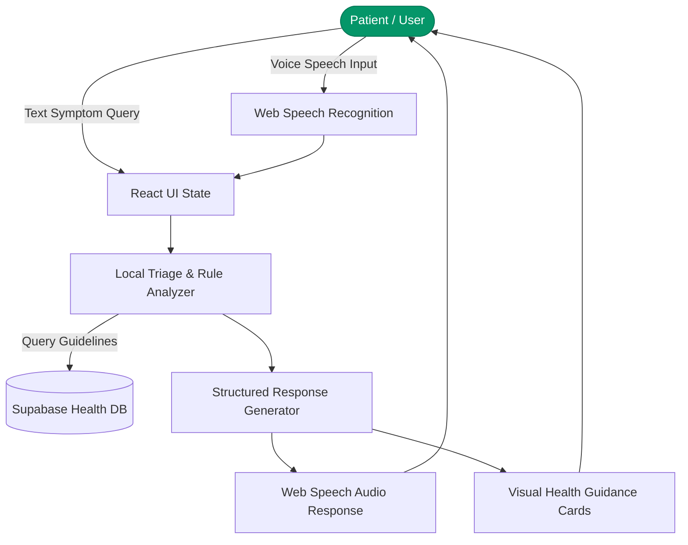

# Arogya Mitra (ಆರೋಗ್ಯ ಸಹಾಯಕ) — Multilingual Healthcare AI Assistant

> Voice-first and text multilingual healthcare triage, symptom guidance, and wellness advisory platform built with React 18, Vite, Supabase, and Web Speech AI.

---

## 1. Project Title
**Arogya Mitra (ಆರೋಗ್ಯ ಸಹಾಯಕ)** — Multilingual Voice & Text Healthcare Intelligence Assistant.

## 2. Project Overview
Arogya Mitra is an assistive healthcare web platform designed to bridge language and literacy barriers in public healthcare. By enabling voice-enabled conversational interfaces in regional Indian languages (Kannada, Hindi) alongside English, it delivers accessible preliminary symptom assessments, basic first-aid protocols, and emergency guidance.

## 3. Problem Statement
Millions of non-English speaking citizens face friction accessing digital healthcare triage. Complex terminology and text-heavy portals alienate rural populations. Arogya Mitra solves this with regional language voice synthesis, audio transcription, and clear, non-diagnostic triage guidance.

## 4. Objectives
- **Implemented:**
  - Real-time bilingual / trilingual speech recognition and text-to-speech feedback.
  - Symptom analysis and categorized health recommendation cards.
  - Emergency SOS shortcuts and nearby clinic discovery helpers.
  - Supabase integration for encrypted user health profile caching.
- **Future Goals:**
  - Direct integration with verified Ayushman Bharat Digital Mission (ABDM) APIs.
  - Offline-first ServiceWorker caching for remote clinic operations.

## 5. Technology Stack
- **Frontend:** React 18, Vite, TypeScript, Tailwind CSS, Lucide React, shadcn/ui
- **Voice / Speech:** Web Speech API (SpeechRecognition & SpeechSynthesis)
- **Backend & Auth:** Supabase (Auth, PostgreSQL database, Edge Functions)
- **Deployment:** Netlify (`netlify.toml`)

## 6. System Architecture


## 7. Folder Structure
```
arogyamitraa/
├── src/
│   ├── components/          # Voice assistant, symptom checker, emergency UI
│   ├── hooks/               # Voice recognition and audio synthesis hooks
│   ├── integrations/        # Supabase client and generated database types
│   ├── pages/               # Dashboard, Triage, Clinic Directory views
│   └── App.tsx              # Core router and language context
├── netlify.toml             # Netlify deployment configuration
├── .env.example             # Clean environment variable specification
├── TESTING_GUIDE.md         # Manual and automated verification checklist
└── README.md                # Enterprise project documentation
```

## 8. Installation & Setup
```bash
# Clone the repository
git clone https://github.com/StratagemVX/arogyamitraa.git
cd arogyamitraa

# Install dependencies
npm install

# Configure environment variables
cp .env.example .env

# Run local development server
npm run dev
```

## 9. Environment Variables (`.env.example`)
```env
VITE_SUPABASE_URL=https://your-project.supabase.co
VITE_SUPABASE_ANON_KEY=your-supabase-anon-key
VITE_FIREBASE_API_KEY=your-firebase-key
```

## 10. Security & Privacy Considerations
- **No Health Data Leakage:** Voice streams are processed in-browser; raw audio recordings are never stored on external third-party servers.
- **Credential Hygiene:** Local certificates (`*.pem`, `*.key`) and `.env` credentials are restricted via `.gitignore`.
- **Medical Disclaimer:** Explicit notices clarify that Arogya Mitra provides triage assistance, not certified physician diagnoses.

## 11. Author & Project Information
- **Lead Developer:** Chethan Kumar B S (`StratagemVX`)
- **Institution:** MVJ College of Engineering
- **Focus:** HealthTech, Multilingual Voice AI, Accessible Healthcare
