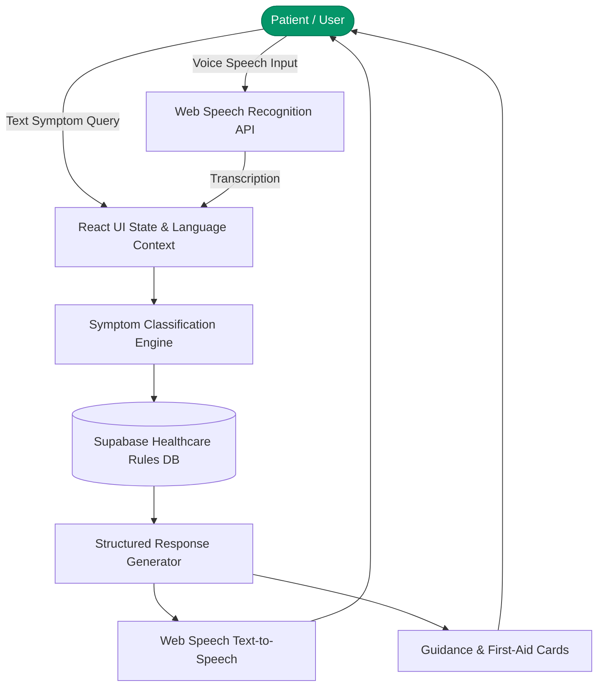

# Arogya Mitra (ಆರೋಗ್ಯ ಸಹಾಯಕ) — Multilingual Healthcare AI Assistant

> An accessible voice-first and text multilingual healthcare triage, preliminary symptom evaluation, and wellness advisory platform built with React 18, Vite, Supabase, and Web Speech AI.

[](https://react.dev/)
[](https://www.typescriptlang.org/)
[](https://supabase.com/)
[](https://developer.mozilla.org/en-US/docs/Web/API/Web_Speech_API)

---

## Executive Overview

Arogya Mitra (ಆರೋಗ್ಯ ಸಹಾಯಕ) is an assistive healthtech web application engineered to dismantle language and digital literacy barriers in public healthcare. Recognizing that rural and underserved demographics often struggle with text-heavy medical portals, Arogya Mitra enables natural voice-guided conversational assessments in regional Indian languages (Kannada, Hindi) alongside English. The platform provides preliminary non-diagnostic symptom categorization, emergency first-aid protocols, and nearest clinic directions.

---

## Problem Statement & Public Health Context

In multilingual societies, healthcare information systems often alienate non-English literate populations. When individuals experience symptoms, delay or panic occurs due to:
1. **Linguistic Exclusion:** Medical information primarily indexed in technical English.
2. **Text Literacy Friction:** Text-heavy triage forms that discourage elderly or rural patients.
3. **Emergency Panic:** Lack of immediate structured guidance for urgent symptoms (e.g. chest pain, dehydration, snakebite).

Arogya Mitra bridges this gap with browser-native speech recognition (`SpeechRecognition`) and text-to-speech synthesis (`SpeechSynthesis`), translating spoken regional queries into structured health guidance.

---

## Core Capabilities & Features

### Implemented Features
- **Trilingual Speech Interaction:** Bi-directional conversational voice recognition supporting Kannada, Hindi, and English.
- **Voice Symptom Triage:** Natural voice input analysis mapping symptoms to clinical guidance categories.
- **Categorized Wellness Guidelines:** Structured advice for lifestyle conditions, seasonal ailments, and home remedies.
- **Emergency SOS Shortcut:** High-visibility emergency actions triggering immediate medical helpline prompts.
- **Profile / Data Integration:** Supabase client integration for application data; verify the deployed database policies before handling real user records.
- **Verified Audio Implementation:** Complete voice documentation guide (`VOICE_ASSISTANT_IMPLEMENTATION.md`) and testing manual (`TESTING_GUIDE.md`).

---

## System Architecture



---

## Directory Structure

```text
arogyamitraa/
├── src/
│   ├── assets/              # Healthcare background imagery (health-bg.jpg)
│   ├── components/          # VoiceAssistant, SymptomChecker, EmergencyBanner
│   ├── hooks/               # useVoiceRecognition, useSpeechSynthesis hooks
│   ├── integrations/        # Supabase client initialization and generated types
│   ├── pages/               # TriageDashboard, ClinicDirectory, ProfileView
│   └── App.tsx              # Router and language context provider
├── netlify.toml             # Netlify deployment and header routing
├── .env.example             # Clean environment variable specification
├── TESTING_GUIDE.md         # Manual and automated verification checklist
├── VOICE_ASSISTANT_IMPLEMENTATION.md # Audio pipeline engineering documentation
└── README.md                # Master repository technical documentation
```

---

## Setup & Installation

```bash
# Clone the repository
git clone https://github.com/StratagemVX/arogyamitraa.git
cd arogyamitraa

# Install dependencies
npm install

# Configure environment
cp .env.example .env

# Start development server
npm run dev
```

---

## Environment Configuration (`.env.example`)

```env
VITE_SUPABASE_URL=https://your-project.supabase.co
VITE_SUPABASE_PUBLISHABLE_KEY=your-supabase-publishable-key
VITE_FIREBASE_API_KEY=your-firebase-key
```

---

## Safety, Privacy & Deployment Notes

- Treat symptom guidance as informational only; it is not a substitute for a qualified clinician or emergency services.
- Review Supabase Row Level Security policies, Firebase rules, and data retention before using real patient information.
- The browser-facing Supabase key is a publishable key, not a service-role credential. Never place privileged keys in `VITE_*` variables or commit `.env` files.

---

## Contributor Attribution & Profile

- **Lead Engineer:** Chethan Kumar B S (`StratagemVX`)
- **Institution:** Department of Computer Science & Engineering, MVJ College of Engineering
- **GitHub:** [https://github.com/StratagemVX](https://github.com/StratagemVX)
- **Portfolio:** [https://chethan-kumar-portfolio.vercel.app/](https://chethan-kumar-portfolio.vercel.app/)
- **LinkedIn:** [https://linkedin.com/in/chethan-kumar-b-s-781a002bb](https://linkedin.com/in/chethan-kumar-b-s-781a002bb)

## Verification and maintenance

Use the source and dependency manifest as the authority for features and operational commands. This project handles user-facing data; verify authorization and privacy behavior when changing data flows.

### Available package scripts

- `npm run dev` — `vite`
- `npm run build` — `vite build`
- `npm run lint` — `eslint .`
- `npm run test` — `vitest run`
- `npm run preview` — `vite preview`

Commands are listed from the package manifest and have not been executed by this documentation change.

### Contribution and security notes

- Keep features, architecture diagrams, screenshots, and technology details aligned with implementation.
- Do not commit secrets, private keys, production data, or local environment files; use placeholder-only examples and deployment-managed secrets.
- Validate authentication, authorization, input validation, and access policies when modifying user data.
- Include reproduction steps and expected/actual behavior in issue reports.
- Run relevant build, lint, and test checks before merging.
